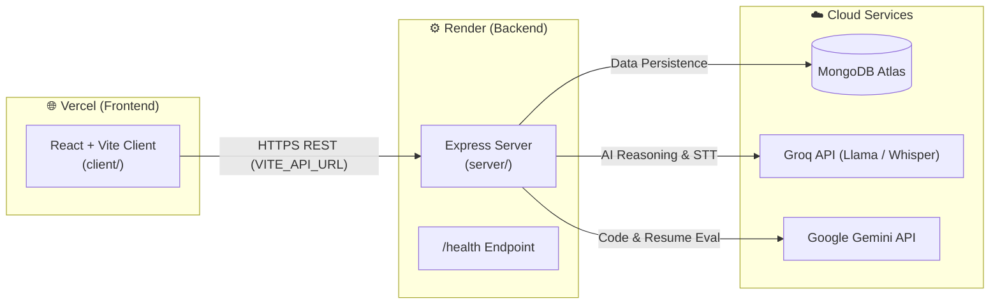

# Smith AI Interview Platform 🤖💼
**Developed by CipherFlux Labs**

An enterprise-ready, premium AI-powered simulator designed to run mock technical, behavioral, and coding interviews. Built with **React + Vite** on the frontend and **Express (Node.js)** on the backend, powered by state-of-the-art Generative AI models from **Google Gemini** and **Groq**.

This repository is organized as a high-performance, decoupled monorepo specifically architected for independent zero-friction cloud hosting:
- 🚀 **Frontend** hosted on **Vercel**
- ⚙️ **Backend** hosted on **Render**

---

## 📁 Perfect Full-Stack Monorepo Structure

```text
smith-ai/
├── client/                          # 🌐 FRONTEND APPLICATION (Deployed on Vercel)
│   ├── public/                      # Static assets & icons
│   ├── src/
│   │   ├── assets/                  # CSS stylesheets, branding, SVGs
│   │   ├── components/              # Modular UI components (Navbar, Modals, Editor)
│   │   ├── context/                 # React state contexts (AuthContext, etc.)
│   │   ├── pages/                   # Application views (Dashboard, Resume, Practice, Profile)
│   │   ├── services/
│   │   │   └── api.js               # Centralized API layer (reads VITE_API_URL)
│   │   ├── App.jsx                  # Main routing & layout controller
│   │   ├── index.css                # Tailwind & design token configurations
│   │   └── main.jsx                 # React root DOM mount
│   ├── .env.example                 # Frontend environment template
│   ├── index.html                   # HTML template
│   ├── package.json                 # Frontend dependencies & Vite scripts
│   ├── tailwind.config.js           # Tailwind CSS configuration
│   ├── vercel.json                  # Vercel configuration (SPA rewrites & cache headers)
│   └── vite.config.js               # Vite config with local development proxy
│
├── server/                          # ⚙️ BACKEND API SERVICE (Deployed on Render)
│   ├── config/                      # Database & service configurations (db.js)
│   ├── middleware/                  # Logger, auth middleware, error handler, rate limiter
│   ├── models/                      # MongoDB Mongoose schemas (User, InterviewSession)
│   ├── routes/                      # Express REST API endpoints (auth, interview, practice)
│   ├── services/                    # AI providers (geminiService, groqService, TTS)
│   ├── .env.example                 # Backend environment template
│   ├── index.js                     # Express application entry (CORS, /health, routing)
│   └── package.json                 # Backend dependencies, start script, Node engines
│
├── scripts/                         # 🛠️ Test automation & smoke tests
│   ├── apiSmokeTest.js              # Express API integration smoke test
│   └── ensurePortFree.js            # Port conflict management script
│
├── .env.example                     # Root unified development environment template
├── .gitignore                       # Multi-tier gitignore (protects secrets, dist, modules)
├── package.json                     # Monorepo task runner (dev, build, install:all)
├── render.yaml                      # Render Blueprint (Infrastructure-as-Code)
├── vercel.json                      # Root Vercel fallback configuration
└── README.md                        # Project documentation & deployment manual
```

---

## ☁️ Deployment Guide

Follow this guide to deploy the backend on **Render** and the frontend on **Vercel**.



---

### Part 1: Deploy Backend on Render ⚙️

You can deploy the backend using either **Render Blueprints (1-Click)** or **Manual Setup**.

#### Option A: Automatic Deploy via Render Blueprint (Recommended)
This repository includes a pre-configured `render.yaml` file:
1. Push your repository to **GitHub**.
2. Log in to [Render Dashboard](https://dashboard.render.com).
3. Click **New +** > **Blueprint**.
4. Connect your GitHub repository.
5. Render will automatically detect `render.yaml` and configure the service.
6. Fill in the required environment variables (API keys and database string) in the prompt, then click **Apply**.

---

#### Option B: Manual Web Service Setup on Render
1. Log in to [Render Dashboard](https://dashboard.render.com).
2. Click **New +** > **Web Service**.
3. Select **Build and deploy from a Git repository** and connect your repository.
4. Configure the service settings as follows:

| Setting | Value | Notes |
| :--- | :--- | :--- |
| **Name** | `smith-ai-backend` | Or any name you prefer |
| **Region** | `Oregon (US West)` | Choose the region closest to your users / database |
| **Branch** | `main` | Production branch |
| **Root Directory** | `server` | ⚠️ **Crucial**: Points Render to the `server/` directory |
| **Runtime** | `Node` | Node.js environment |
| **Build Command** | `npm install` | Installs server dependencies |
| **Start Command** | `node index.js` | Launches Express server |
| **Instance Type** | `Free` (or Starter) | Free tier available |

5. Scroll down to **Advanced** and set:
   - **Health Check Path:** `/health` *(Render monitors this to verify service health)*

6. In the **Environment Variables** tab, add the following keys:

| Environment Variable | Recommended Value / Description | Required |
| :--- | :--- | :--- |
| `NODE_ENV` | `production` | Yes |
| `PORT` | `10000` (Render injects this automatically) | Yes |
| `MONGODB_URI` | `mongodb+srv://<user>:<password>@cluster.mongodb.net/smith_ai?retryWrites=true&w=majority` | Yes |
| `JWT_SECRET` | Strong random string (e.g. `c7b6...`) | Yes |
| `GEMINI_API_KEY` | Your Google Gemini API Key | Yes |
| `GROQ_API_KEY` | Your Groq Cloud API Key | Yes |
| `GROQ_MODEL` | `openai/gpt-oss-20b` (or chosen Groq model) | Yes |
| `GROQ_WHISPER_API_KEY` | Your Groq Whisper API Key | Yes |
| `CLIENT_ORIGINS` | `https://<your-vercel-domain>.vercel.app` *(add after frontend deploy)* | Yes |
| `CLIENT_ORIGIN` | `https://<your-vercel-domain>.vercel.app` | Optional |

7. Click **Create Web Service**.
8. Once built, copy your **Render Service URL** (e.g., `https://smith-ai-backend.onrender.com`). You will need this for Vercel.

> [!TIP]
> **MongoDB Atlas IP Whitelist:** Ensure that your MongoDB Atlas Network Access allows connections from `0.0.0.0/0` (Allow Access from Anywhere) so Render dynamic container IPs can connect.

---

### Part 2: Deploy Frontend on Vercel 🌐

1. Log in to [Vercel Dashboard](https://vercel.com).
2. Click **Add New...** > **Project**.
3. Import your **smith-Ai** GitHub repository.
4. In the **Configure Project** screen, apply the following settings:

| Setting | Value | Notes |
| :--- | :--- | :--- |
| **Framework Preset** | `Vite` | Auto-detected |
| **Root Directory** | `client` | ⚠️ Click **Edit** and choose `client` |
| **Build Command** | `npm run build` | Default |
| **Output Directory** | `dist` | Default |
| **Install Command** | `npm install` | Default |

5. Under **Environment Variables**, add:

| Key | Value | Notes |
| :--- | :--- | :--- |
| `VITE_API_URL` | `https://smith-ai-backend.onrender.com` | ⚠️ **Your Render backend URL without trailing slash (`/`)** |

6. Click **Deploy**.
7. Vercel will build and assign your production URL (e.g. `https://smith-ai-platform.vercel.app`).

> [!NOTE]
> If you leave **Root Directory** as `./` in Vercel instead of `client`, the included root `vercel.json` will automatically route the build to `client` and output from `client/dist`. However, setting Root Directory to `client` directly in the Vercel UI is the recommended standard.

---

### Part 3: Connect Frontend & Backend (Final Handshake) 🤝

Once your Vercel deployment is live:
1. Copy your Vercel URL (e.g., `https://smith-ai-platform.vercel.app`).
2. Go back to your **Render Dashboard** > Select `smith-ai-backend` > **Environment**.
3. Update `CLIENT_ORIGINS`:
   ```env
   CLIENT_ORIGINS=http://localhost:5173,https://smith-ai-platform.vercel.app
   ```
4. Render will automatically redeploy with the updated CORS configuration.
5. Visit your Vercel URL and open the browser console (`F12`). You should see normal API traffic with zero CORS issues!

> [!IMPORTANT]
> **Render Free Tier Spin-up (Cold Starts):**  
> On Render's Free tier, services spin down after 15 minutes of inactivity. When a new request arrives, it may take 30–50 seconds for the backend instance to spin back up. You can check `https://<your-render-url>/health` anytime to see if the server is awake.

---

## 💻 Local Development Setup

To run both client and server locally on your machine:

### 1. Clone the repository
```bash
git clone https://github.com/chakrichitteti24-afk/smith-Ai.git
cd smith-Ai
```

### 2. Install all dependencies
```bash
npm run install:all
```
*Installs dependencies in both `server/` and `client/`.*

### 3. Setup Environment Variables
Create a `.env` file in the root directory (or copy from `.env.example`):
```env
PORT=3001
NODE_ENV=development
GROQ_API_KEY=your_groq_api_key
GROQ_WHISPER_API_KEY=your_groq_whisper_key
GEMINI_API_KEY=your_gemini_api_key
CLIENT_ORIGINS=http://localhost:5173
MONGODB_URI=your_mongodb_atlas_connection_string
JWT_SECRET=your_development_jwt_secret
```

### 4. Run Development Servers
```bash
npm run dev
# OR to automatically ensure port 3001 is freed first:
npm run dev:clean
```
- **Frontend:** `http://localhost:5173`
- **Backend API:** `http://localhost:3001`
- *Vite's built-in dev proxy routes `/api/*` and `/health` requests seamlessly to `http://localhost:3001`.*

---

## 🧪 Testing Suite

### Run Backend API Smoke Test
```bash
npm run test:api
```
Validates:
- Health check status (`/health`)
- Interview AI prompt generation (`/api/interview/start`)
- Interview response parsing (`/api/interview/respond`)
- User Registration, JWT Login, and Profile Retrieval (`/api/auth/*`)

---

## 🛠️ Summary of Deployment Configuration Files

| File | Purpose | Cloud Target |
| :--- | :--- | :--- |
| `render.yaml` | Infrastructure as Code Blueprint specifying runtime, rootDir, commands, and healthCheck | **Render** |
| `server/index.js` | Express server configured with dynamic CORS (`.vercel.app`), dynamic `PORT`, and `/health` | **Render** |
| `client/vercel.json` | Single Page Application (SPA) fallback rewrites and static asset caching | **Vercel** |
| `client/vite.config.js` | Build configurations and local development reverse proxy | **Vercel / Local** |
| `vercel.json` | Root monorepo fallback configuration | **Vercel** |

---

## 📄 License

Copyright © 2026 CipherFlux Labs. All Rights Reserved.

Smith AI is proprietary software. The public repository is provided for viewing and reference purposes only. No permission is granted to copy, modify, redistribute, reproduce, resell, or use the source code or associated project materials without prior written permission from CipherFlux Labs.
