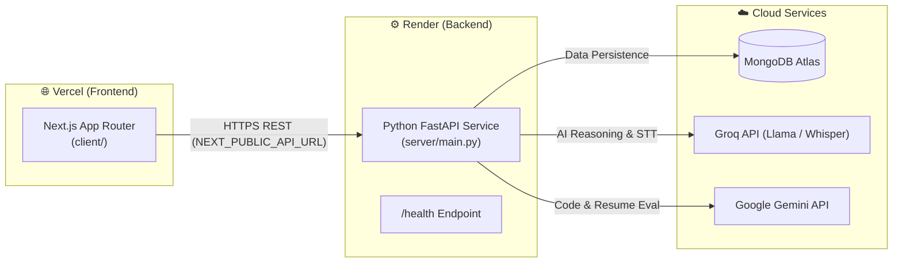

# Smith AI Interview Platform 🤖💼
**Developed by CipherFlux Labs**

An enterprise-ready, premium AI-powered simulator designed to run mock technical, behavioral, and coding interviews. Built with **Next.js (App Router)** on the frontend and **Python FastAPI** on the backend, powered by state-of-the-art Generative AI models from **Google Gemini** and **Groq**.

This repository is organized as a high-performance, decoupled monorepo specifically architected for independent zero-friction cloud hosting:
- 🚀 **Frontend:** **Next.js (App Router)** hosted on **Vercel**
- ⚙️ **Backend:** **Python FastAPI** hosted on **Render**

---

## 📁 Perfect Full-Stack Monorepo Structure

```text
smith-ai/
├── client/                          # 🌐 NEXT.JS FRONTEND APPLICATION (Deployed on Vercel)
│   ├── public/                      # Static assets & icons
│   ├── src/
│   │   ├── app/                     # Next.js App Router Structure
│   │   │   ├── layout.jsx           # Root layout with fonts, metadata & AuthProvider
│   │   │   ├── page.jsx             # Home / Dashboard landing page
│   │   │   ├── globals.css          # Tailwind CSS & design tokens
│   │   │   ├── interview/page.jsx   # /interview (45-min simulation)
│   │   │   ├── pitching/page.jsx    # /pitching route alias
│   │   │   ├── practice/page.jsx    # /practice (Monaco code sandbox)
│   │   │   ├── resume/page.jsx      # /resume (ATS resume intelligence)
│   │   │   ├── profile/page.jsx     # /profile (Candidate telemetry & settings)
│   │   │   ├── login/page.jsx       # /login view
│   │   │   ├── signup/page.jsx      # /signup view
│   │   │   └── auth/page.jsx        # /auth universal view
│   │   ├── components/              # UI components (Navbar, AuthModal, Monaco Editor)
│   │   ├── context/                 # Context providers (AuthContext with 'use client')
│   │   ├── views/                   # Full-page feature views (Dashboard, Pitching, etc.)
│   │   └── services/
│   │       └── api.js               # API service layer (reads NEXT_PUBLIC_API_URL)
│   ├── .env.example                 # Frontend env template (NEXT_PUBLIC_API_URL)
│   ├── next.config.mjs              # Next.js configuration & local development proxy
│   ├── package.json                 # Next.js dependencies & scripts (next build/dev)
│   ├── tailwind.config.js           # Tailwind CSS configuration
│   └── vercel.json                  # Vercel configuration & OWASP security headers
│
├── server/                          # ⚙️ FASTAPI BACKEND SERVICE (Deployed on Render)
│   ├── config.py                    # Environment & database configuration
│   ├── database.py                  # Database connection lifecycle
│   ├── database_mongo_auth.py       # MongoDB Atlas auth & user profile management
│   ├── database_sqlalchemy.py       # SQLAlchemy ORM for practice questions & analytics
│   ├── main.py                      # FastAPI app entry point (CORS, /health, routing)
│   ├── models_py.py                 # Pydantic data schemas
│   ├── requirements.txt             # Python dependencies (FastAPI, uvicorn, groq, etc.)
│   ├── routers/                     # FastAPI route modules
│   │   ├── auth_router.py           # /api/auth routes (JWT, register, login)
│   │   ├── interview_router.py      # /api/interview routes (AI simulation, Groq, Gemini)
│   │   └── practice_router.py       # /api/practice routes (code sandbox & stats)
│   ├── services_py/                 # Python AI services (Groq, Gemini, TTS)
│   └── .env.example                 # Backend environment variable template
│
├── scripts/                         # 🛠️ Test automation & smoke tests
├── .env.example                     # Root unified development environment template
├── .gitignore                       # Multi-tier gitignore (protects secrets, dist, .next)
├── package.json                     # Monorepo task runner (dev:py, build, install:all)
├── render.yaml                      # Render Blueprint (Infrastructure-as-Code for FastAPI)
├── vercel.json                      # Root Vercel configuration for Next.js
└── README.md                        # Project documentation & deployment manual
```

---

## ☁️ Deployment Guide

Follow this guide to deploy the backend on **Render** (Python FastAPI) and the frontend on **Vercel** (Next.js).



---

### Part 1: Deploy Backend on Render (Python FastAPI) ⚙️

You can deploy the backend using either **Render Blueprints (1-Click)** or **Manual Setup**.

#### Option A: Automatic Deploy via Render Blueprint (Recommended)
This repository includes a pre-configured `render.yaml` file targeting Python FastAPI:
1. Push your repository to **GitHub**.
2. Log in to [Render Dashboard](https://dashboard.render.com).
3. Click **New +** > **Blueprint**.
4. Connect your GitHub repository.
5. Render will automatically detect `render.yaml` and configure the Python service with `pip install -r requirements.txt` and `uvicorn main:app`.
6. Fill in your environment variables in the prompt and click **Apply**.

---

#### Option B: Manual Web Service Setup on Render
1. Log in to [Render Dashboard](https://dashboard.render.com).
2. Click **New +** > **Web Service**.
3. Connect your GitHub repository and apply these exact settings:

| Setting | Value | Notes |
| :--- | :--- | :--- |
| **Service Type** | **Web Service** | Python Web API |
| **Name** | `smith-ai-backend` | Or any name you prefer |
| **Region** | `Oregon (US West)` | Select closest to your users |
| **Branch** | `main` | Production branch |
| **Root Directory** | `server` | ⚠️ **Crucial**: Points Render to `server/` |
| **Runtime** | `Python 3` | Python runtime |
| **Build Command** | `pip install -r requirements.txt` | Installs FastAPI, Uvicorn, etc. |
| **Start Command** | `uvicorn main:app --host 0.0.0.0 --port 10000` | Launches ASGI server |
| **Instance Type** | `Free` (or Starter) | Free tier available |

4. Scroll down to **Advanced** and set:
   - **Health Check Path:** `/health` *(FastAPI has a native `/health` check)*

5. In the **Environment Variables** tab, paste the following keys:

```env
PORT=10000
PYTHON_VERSION=3.11.9
NODE_ENV=production

GROQ_API_KEY=your_groq_api_key_here
GROQ_MODEL=openai/gpt-oss-20b
GROQ_WHISPER_API_KEY=your_groq_whisper_api_key_here

GEMINI_API_KEY=your_gemini_api_key_here

MISTRAL_API_KEY=your_mistral_api_key_here
MISTRAL_MODEL=mistral-small-latest

SUPABASE_URL=https://your-supabase-project.supabase.co
SUPABASE_KEY=your_supabase_anon_key_here

MONGODB_URI=mongodb+srv://<username>:<password>@cluster0.zq344k9.mongodb.net/smith_ai?retryWrites=true&w=majority
MONGODB_AUTH_URI=mongodb+srv://<username>:<password>@cluster0.zq344k9.mongodb.net/smith_ai?retryWrites=true&w=majority
MONGODB_DB_NAME=smith_ai

JWT_SECRET=your_super_secret_jwt_key_here
CLIENT_ORIGIN=https://<your-vercel-domain>.vercel.app
CLIENT_ORIGINS=http://localhost:3000,https://<your-vercel-domain>.vercel.app
```

6. Click **Create Web Service**.
7. Once deployed, copy your **Render Service URL** (e.g. `https://smith-ai-backend.onrender.com`).

> [!TIP]
> **MongoDB Atlas IP Whitelist:** Ensure that your MongoDB Atlas Network Access allows connections from `0.0.0.0/0` (Allow Access from Anywhere) so Render dynamic container IPs can connect.

---

### Part 2: Deploy Frontend on Vercel (Next.js) 🌐

1. Log in to [Vercel Dashboard](https://vercel.com).
2. Click **Add New...** > **Project**.
3. Import your **smith-Ai** GitHub repository.
4. In the **Configure Project** screen, apply these settings:

| Setting | Value | Notes |
| :--- | :--- | :--- |
| **Framework Preset** | `Next.js` | Auto-detected by Vercel |
| **Root Directory** | `client` | ⚠️ Click **Edit** and choose `client` |
| **Build Command** | `next build` | Default |
| **Output Directory** | `.next` | Default |
| **Install Command** | `npm install` | Default |

5. Under **Environment Variables**, add:

| Key | Value | Notes |
| :--- | :--- | :--- |
| `NEXT_PUBLIC_API_URL` | `https://smith-ai-backend.onrender.com` | ⚠️ **Your Render backend URL without trailing slash (`/`)** |

6. Click **Deploy**.
7. Vercel will build your Next.js application and assign your production URL (e.g. `https://smith-ai-platform.vercel.app`).

---

### Part 3: Connect Frontend & Backend (CORS Handshake) 🤝

1. Copy your Vercel domain (e.g., `https://smith-ai-platform.vercel.app`).
2. Go back to **Render Dashboard** > Select `smith-ai-backend` > **Environment**.
3. Set `CLIENT_ORIGIN` and `CLIENT_ORIGINS`:
   ```env
   CLIENT_ORIGIN=https://smith-ai-platform.vercel.app
   CLIENT_ORIGINS=http://localhost:3000,https://smith-ai-platform.vercel.app
   ```
4. Render will automatically redeploy.
5. In addition, `server/main.py` includes automatic regex matching (`allow_origin_regex=r"^https:\/\/.*\.vercel\.app$"`) to guarantee that all Vercel preview branch deployments are automatically allowed by CORS!

---

## 💻 Local Development Setup

To run both Next.js and FastAPI locally:

### 1. Install Dependencies
```bash
# Install root & client dependencies
npm install --prefix client
```

### 2. Configure Local Environment
Create `.env` in the root directory:
```env
PORT=3001
NODE_ENV=development
GROQ_API_KEY=your_groq_api_key
GROQ_WHISPER_API_KEY=your_groq_whisper_key
GEMINI_API_KEY=your_gemini_api_key
CLIENT_ORIGIN=http://localhost:3000
MONGODB_URI=your_mongodb_connection_string
JWT_SECRET=your_development_jwt_secret
```

### 3. Start Development Servers
```bash
# Terminal 1: Run FastAPI backend
cd server
python -m uvicorn main:app --host 127.0.0.1 --port 3001 --reload

# Terminal 2: Run Next.js frontend
cd client
npm run dev
```

Or concurrently from the project root:
```bash
npm run dev:py
```

- **Next.js Frontend:** `http://localhost:3000`
- **FastAPI Backend:** `http://127.0.0.1:3001`
- **API Docs (Swagger UI):** `http://127.0.0.1:3001/docs`

---

## 🛡️ OWASP Top 10 Security Compliance Matrix

This application adheres to and enforces all ten categories of the **OWASP Top 10** across the FastAPI services, Next.js frontend, and cloud hosting infrastructure:

| OWASP Category | Vulnerability Risk | Implemented Security Countermeasure |
| :--- | :--- | :--- |
| **A01: Broken Access Control** | Unauthorized data tampering & mass assignment | Whitelist-enforced profile update filters (`ALLOWED_PROFILE_FIELDS`), role & user ID isolation via verified JWT authorization (`authMiddleware`). |
| **A02: Cryptographic Failures** | Credential cracking & signature timing attacks | High-iteration PBKDF2 hashing (100,000 rounds with random salt), constant-time `crypto.timingSafeEqual` for password verification & HMAC-SHA256 signature checks. |
| **A03: Injection** | NoSQL operator injection & Remote Code Execution (RCE) | Recursive MongoDB operator sanitizer (`mongoSanitize` middleware stripping `$*` and `.*`), strict primitive type checks, and code sandbox AST/token safety guards against system process calls. |
| **A04: Insecure Design** | Unlimited brute-force and malicious file uploads | Strict multi-tier rate limiting (isolated sliding windows), 10MB memory-only file storage, and whitelisted MIME/extension verification (`.pdf`, `.docx`, `.txt`, `.webm`). |
| **A05: Security Misconfiguration** | Information disclosure & header vulnerabilities | Production-grade `helmet` & FastAPI security headers middleware, disabled `x-powered-by`, strict CORS origin matching, and sanitized 500-level error messages in production. |
| **A06: Vulnerable Components** | Outdated or insecure packages | Automated dependency auditing, explicit version locking with `package-lock.json`, and engine runtime enforcement (`node >= 18.0.0`, `python 3.11`). |
| **A07: Identification & Auth Failures** | Credential stuffing & password guessing | Dedicated authentication rate limiter (`authLimiter`: max 20 requests / 15 minutes per IP), enforced 8+ character password length, and uniform authentication error responses. |
| **A08: Software & Data Integrity** | Body payload flooding & parameter tampering | Strict 1MB body parser payload limits (`express.json({ limit: '1mb' })`), strict JSON parsing, and schema validation. |
| **A09: Security Logging & Monitoring** | Audit failure & credential leakage in logs | Structured JSON request and security violation logging with automated redaction of sensitive fields (`password`, `token`, `secret`, `apiKey`). |
| **A10: Server-Side Request Forgery (SSRF)** | Internal network reconnaissance & metadata access | Controlled external API integrations strictly restricted to verified external endpoints (Google Gemini, Groq, Wandbox) with zero user-controlled outbound URL fetches. |

---

## 📄 License

Copyright © 2026 CipherFlux Labs. All Rights Reserved.

Smith AI is proprietary software. The public repository is provided for viewing and reference purposes only. No permission is granted to copy, modify, redistribute, reproduce, resell, or use the source code or associated project materials without prior written permission from CipherFlux Labs.
